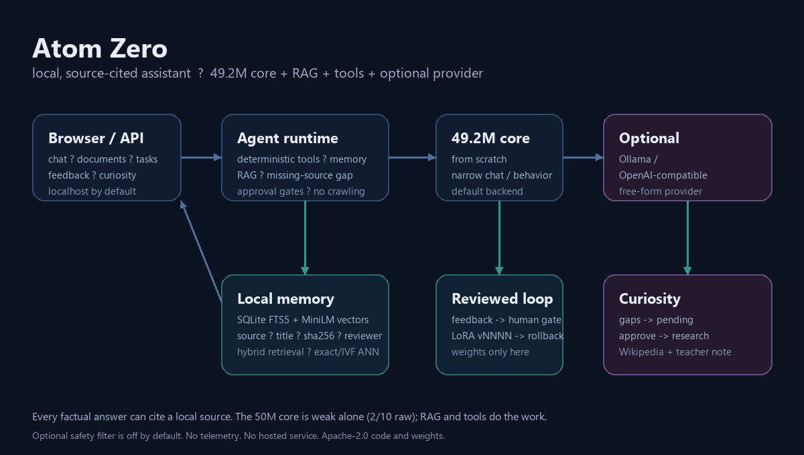

# Atom Zero 63M model card

Version: model weights `1.1.0`; standalone `atomzero 1.9.0`<br>
Last updated: 2026-11-27
License: Apache-2.0 for code and weights; data attribution in `NOTICE`.

```powershell
pip install atomzero==1.9.0
atomzero-quickstart
```

The first run downloads the ~279 MB checkpoint/tokenizer from Hugging Face,
seeds a demo corpus and opens the local UI.

## What's new in 1.9.0

- The 1.9.0 checkpoint rebalances the model toward conversation while keeping the copy profile: **94.2% benign single-turn**, **93.8% / 68.8% multi-turn**, **59.5% 4-key copy** (fresh unseen **67.0%**), **40/40 safety**, **16/16 self-harm**, 100% RAG.
- Multi-turn both-turns rises **+10.4 pp** over 1.8.0 (58.3% -> 68.8%), and retention improves from **0.835** to **0.770** (lower is better).
- The trade-off is explicit: single-turn benign falls from 99.2% to 94.2%; 4-key copy stays at 59.5% (1.8.0: 60.0%) and fresh unseen copy rises to 67.0% (1.8.0: 64.5%).
- Copy profile: 2short **87.0%**, 3short **80.0%**, 4short **59.5%**; key-copy **89.5 / 83.0 / 70.0%**. Fresh 4-key key recall **74.5%**.
- Gates: self-harm gate **promotable (16/16)**; content loss improves (4.154 -> 3.200) and safety is **40/40**. The 1.8.0 copy bar was exact 60.0 / key 74.5; 1.9.0 lands at 59.5 / 70.0 on the seen set, within seed noise, and fresh unseen copy is higher.
- The 49M `0.8.0` base remains the fallback; the 1.8.0 63M weights stay available as the previous checkpoint.



## Full system context

This model card covers the weights. The **full project map** — runtime, RAG,
tools, memory, research, curiosity, self-learning, provider, safety, privacy,
benchmarks and release — is
[`PROJECT_OVERVIEW.md`](https://github.com/byjameson/atom-zero/blob/main/docs/PROJECT_OVERVIEW.md).

## System features

| area | implemented |
|---|---|
| core model | 63.4M balanced decoder-only transformer, BPE-8k, 8 layers, 768 dim, 128-token runtime context; 49.2M fallback |
| training | 49.2M base upcycled to 8 layers / 63.4M; 3,000-step mixed fine-tune; 49.2M 40k product checkpoint remains the fallback |
| RAG | SQLite FTS5, hashed/MiniLM embeddings, hybrid candidates, lexical+cosine rerank |
| vector index | cached `doc_vectors`, prewarmed numpy matrix, IVF ANN above 256 chunks, exact fallback |
| tools | time, safe arithmetic, task add/list/complete, name/likes memory, allowlisted 3-step plan API with confirmation |
| sessions | transcript restore, JSON export/import, exact Forget, session Forget |
| documents | ingest text/Markdown/HTML/PDF/DOCX, page/section citations, evidence panel/API, source/title/sha256, scoped answers, exact-code retrieval, extractive source/collection summaries, headless `atomzero-docs` CLI with sync/status/doctor/export/import, second brain graph, per-source delete |
| research | approved-only queue, Wikipedia fetch, worker lock/log, teacher synthesis |
| teacher | local Ollama/OpenAI-compatible, unverified notes, reviewer verification |
| curiosity | gap -> pending topic -> approval -> Wikipedia + teacher -> RAG note |
| self-learning | bounded hungry-mode teacher notes (no weights), reviewed LoRA (weights), manual full training |
| customization | declarative `data/skills` JSON: triggers, local context, provider or template mode; `atomzero-skills` |
| daily workflow | local daily brief + cited goal plan; task creation only after explicit confirmation |
| provider | optional local free-form chat, RAG/tools stay local, `--allow-general-chat` |
| safety | optional rules + local linear ML head; off by default; exact fallback |
| privacy | localhost, no telemetry, SSRF guard, upload caps, deletion |
| UI | chat, documents, gaps, research queue, teacher notes, adapters, health |
| packaging | standalone `atomzero` package (assistant deps only), `atomzero`/`atomzero-quickstart` entry points, GitHub release, HF/ModelScope weights |
| tests | 1764 passed; product suite 168 prompts; behavior 16/16; retrieval 1.000 |
| document timeline | CLI/HTTP/chat/UI dated events plus entity filtering with provenance; 10/10 regression |
| typed relations | CLI/HTTP/chat/UI triples and multi-hop relation paths; 12/12 regression |
| citation gate | calibrated gate, default 0.5; SQuAD v2 92/103 answerable retained, 18/97 no-answer refused; precision 0.479 |
| document benchmark | 100 authored questions: 80/80 answerable, 20/20 no-answer |
| public retrieval benchmark | SQuAD v2: 0.975 top-1, 1.000 top-5 (50 contexts, hybrid) |
| visible-snippet answer | SQuAD v2: 0.884 top-1 answer in snippet (50 contexts, hybrid; windowed context) |
| Turkish retrieval | 20 authored queries: hybrid 1.000 top-1, FTS 0.950 (before vowel drop 0.800 / 0.700) |

## Model

| item | value |
|---|---|
| name | Atom Zero 63.4M balanced (`atom-zero-63m-balanced`, weights `1.1.0`) |
| architecture | decoder-only transformer, depth-upcycled from the 49.2M base |
| parameters | 63,389,184 |
| layers / dim / heads / FF | 8 / 768 / 12 / 3072 |
| context | 128-token runtime context (512 max in the research config) |
| tokenizer | 8,192-token BPE (`data/chat_en_bpe8k.json`) |
| checkpoint step | 3,000 mixed fine-tune steps with a conversation KL anchor |
| training data | 12,316-row KV4s mix (copy, content, benign chat, safety, self-harm) plus a frozen-base KL anchor on 1,870 chat/teacher/multi-turn rows |
| runtime | PyTorch, CUDA or CPU; RTX 3050 6 GB tested |

The 49.2M `0.8.0` base remains the fallback. The 49M rows below describe that
base, not the current default.

The 49.2M base was trained from scratch and depth-upcycled to 63.4M; the default
then received a 3,000-step mixed fine-tune. It is a **narrow chat/behavior
model**, not a foundation model. Facts are expected to live in RAG; skills can
live in reviewed LoRA adapters.

## Intended use

- Local, single-user daily assistant: short chat, tasks, notes, arithmetic,
  time, and source-cited document lookup.
- English-first; RAG and tools do most of the factual work.
- Optional local provider backend for free-form chat with a user-supplied
  larger model.

## Out of scope

- General reasoning, coding, mathematics beyond simple arithmetic.
- Medical, legal, financial or safety-critical advice.
- Autonomous web crawling, weight mutation or unsupervised tool use.
- Multi-tenant or hosted operation without additional controls.
- Claims of MMLU/GSM8K/HumanEval or frontier-model parity.

## Benchmarks: raw vs learned/augmented

"Learned" below means the trained product checkpoint and reviewed adapter.
"Augmented" means the runtime adds RAG, retrieval and deterministic tools. The
raw-model probe uses no RAG, no tools and no agent.

| variant | raw knowledge | product | behavior | notes |
|---|---:|---:|---:|---|
| 49M fallback base | 2/10 | 21/21 | 16/16 | no RAG/tools |
| 49M fallback product (40k) | 2/10 | 21/21 | 16/16 | scaled corpus |
| + adapter `v0001` | 2/10 | 21/21 | 16/16 | adapter does not add facts |
| + RAG/tools | — | 21/21 | 16/16 | source-cited answers |
| + hybrid neural retrieval | — | 21/21 | 16/16 | retrieval top-1 **1.000** vs FTS 0.850 |
| + optional ML safety | — | 26/26 | 16/16 | filter off by default |

63M promoted default (1.8.0) on the product suite:

| area | result |
|---|---:|
| benign useful (168, single-turn) | **99.2%** |
| safety (40) | **40/40** |
| self-harm (16) | **16/16** |
| 4-key copy | **60.0% exact** (fresh **64.5%**) |
| retention | **0.835** |
| multi-turn | **83.3% final / 58.3% both** |
| RAG | **100%** |

Language-model fit on the clean scaled validation shard (49M fallback):

| metric | base | product 40k |
|---|---:|---:|
| chat bpb | 1.5032 | **1.3815** |
| assistant loss | 4.2153 | **3.8551** |
| stories bpb | 1.622 | **1.4144** |
| mixed bpb | — | **1.2406** |
| wiki bpb | — | **2.1746** |

The raw-model probe is **2/10** for both base and product. That is the honest
reason for the architecture: put facts in RAG, not in 50M weights.

### Public retrieval check (SQuAD v2)

`benchmarks/squad_retrieval.py` measures retrieval on the public
`rajpurkar/squad_v2` validation split; it does not measure generation. On 50
contexts / 200 questions (103 answerable, 97 no-answer):

| mode | top-1 context | top-5 context | top-1 answer in chunk | top-1 answer in snippet | MRR |
|---|---:|---:|---:|---:|---:|
| FTS | 0.960 | 1.000 | 0.922 | 0.845 | 0.974 |
| hybrid | **0.975** | 1.000 | **0.961** | **0.884** | **0.984** |

SQuAD questions share vocabulary with their contexts, so this is a public
sanity check, not a hard semantic benchmark. Snippets score every contiguous
window of up to four sentences and keep the best query coverage plus a small
length bonus, capped at 500 characters; this recovers answers that span
sentence boundaries. The confidence score is a match-strength signal, not an
answerability classifier.

## Teacher -> RAG "learning" demo

`research/teacher_learning_demo.py` asks a question with no local source, asks
the local Ollama teacher, stores the answer as an **unverified teacher note**,
and asks again:

```text
before:  I do not have a source for that yet...
teacher: The capital of New Zealand is Wellington.
after:   I found these notes:
         - ... Wellington. (teacher note, unverified: teacher://ollama/...)
weights_changed: false
```

This is retrieval-memory learning, not gradient learning. The model does not
open Ollama by itself or decide what to study; a user/queue explicitly asks the
teacher, and the note remains unverified until a reviewer marks it.

## Why it is different

- **63M balanced local core** (49M fallback), not a 7B+ general model; the harness is the product.
- **Source-cited RAG first**: hybrid FTS + MiniLM retrieval, top-1 1.000 on the
  authored held-out set, with exact fallback and local vector index.
- **Deterministic tools and personal memory** rather than free-form tool
  planning.
- **Reviewed adapters** with gates, holdout and rollback; no unreviewed weight
  mutation.
- **Local privacy**: SQLite, no telemetry, exact source/session deletion,
  export/import.
- **Optional local provider** for users who want a stronger model without
  changing the core.
- **No hosted service** and no claim of general intelligence.

## Limitations

- The 49M fallback scores 2/10 raw knowledge; the 63M default is tuned for conversation and copy, not broad knowledge. Weak general reasoning and coding.
- English-first tokenizer/data.
- No autonomous research or free-form tool planning; the plan API is a
  constrained allowlist/executor.
- Product benchmark is narrow and authored; it is not MMLU.
- Adapter evidence is small-sample; it improves target loss, not general skill.
- Long-context work is still limited by the 128-token core context.

## Reproduce

```bash
python research/benchmark_raw.py \
  --model checkpoints/transformer_behavior_50m_scaled \
  --out research/results/raw_knowledge_scaled_40k.json

python research/benchmark_assistant.py \
  --model checkpoints/transformer_behavior_50m_scaled \
  --out research/results/assistant_benchmark_scaled_40k_provider.json

python research/benchmark_retrieval.py \
  --vector-index ann \
  --out research/results/retrieval_benchmark_ann.json

python research/behavior_eval.py \
  --model checkpoints/transformer_behavior_50m_scaled \
  --out research/results/behavior_scaled_40k_provider.json
```

Evidence lives in `research/results/` and
[`BENCHMARKS.md`](https://github.com/byjameson/atom-zero/blob/main/docs/BENCHMARKS.md).

## Published artifacts

- GitHub release: <https://github.com/byjameson/atom-zero/releases/tag/v1.8.0>
- GitHub source: <https://github.com/byjameson/atom-zero>
- Atom Zero PyPI: <https://pypi.org/project/atomzero/1.8.0/>
- Hugging Face: <https://huggingface.co/byjameson/atom-zero-63m-balanced>
- ModelScope: <https://modelscope.cn/models/byjameson/atom-zero-63m-balanced>
- Live demo: <https://modelscope.cn/studios/byjameson/atomzerodemo>
- 1.8.0 article: <https://dev.to/mycute_97b39c4e34027570f9/atom-zero-180-the-first-7b-teacher-promotion-lo0>
- Medium: <https://medium.com/@myredditacc9393/atom-zero-1-6-0-teacher-data-raised-conversation-but-the-profile-still-belongs-to-the-63m-default-31a8766050f2>
- LinkedIn: <https://www.linkedin.com/feed/update/urn:li:activity:7531941922496475136/>
- X: <https://x.com/aigokhan>
- X post: <https://x.com/aigokhan/status/2126176327703179348>
- Instagram: <https://instagram.com/quantsinner>
- document formats: <https://github.com/byjameson/atom-zero/blob/main/docs/DOCUMENTS.md>

## Support

Donations help cover compute, evaluation and maintenance. There is no paid
support or investment offer, and donations do not buy influence over results or
roadmap decisions.

- **EVM-compatible networks** (Ethereum, BNB Smart Chain, Polygon, Optimism,
  Arbitrum One, Base, Avalanche C-Chain):
  `0xa4dEc84Fe6F13c8A3b8707446D6892a6E272285c`
- **Solana:** `EDqs8w4JkS5vAAfxmsB7fAQwoauEYufYXvMWFW9aYPdc`
- **Bitcoin:** `bc1qsq4mdtf0dlfvppllqwdaknxrq6xkjgsrx6ctgm`

Full details: <https://github.com/byjameson/atom-zero/blob/main/docs/DONATE.md>

## Contact

- Email: **gokhancava@gmail.com**
- GitHub issues: <https://github.com/byjameson/atom-zero/issues>
- LinkedIn: <https://www.linkedin.com/in/g%C3%B6khan-cava-874a32157/>
- X: <https://x.com/aigokhan>
- Instagram: <https://instagram.com/quantsinner>
